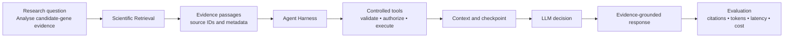
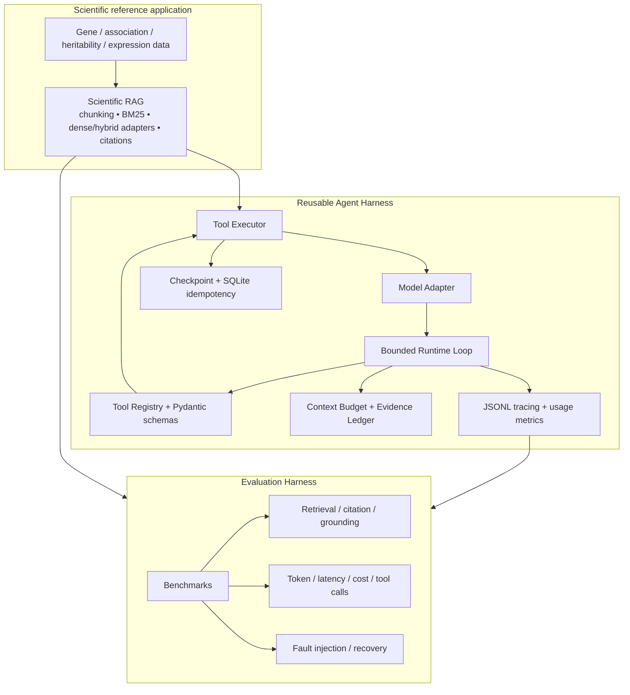
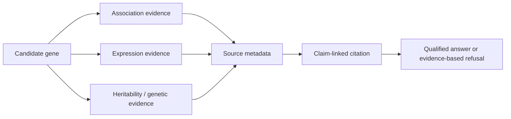

<p align="center">
  
  
</p>

<h1 align="center">BioAgent-Eval</h1>

<p align="center">
  <strong>Scientific RAG × Agent Runtime × Reproducible Evaluation</strong><br>
</p>

<p align="center">
  
  
  
  
</p>

<p align="center">
  A Python execution layer for reliable, traceable and measurable scientific agents.
</p>


BioAgent-Eval addresses a practical research workflow: scientists need to examine whether a candidate gene has evidence related to a disease or phenotype, but the evidence is distributed across heterogeneous collections and must remain traceable to its source. The project preserves the existing Scientific RAG foundation and adds a reusable Agent Harness that controls tool execution, state, recovery, observability and evaluation.

This is not a chatbot-first project. The primary deliverable is an execution and evaluation platform for evidence-grounded scientific agents.

## Why this project exists

```text
Research question
      │
      ▼
Gene / phenotype / variant evidence is spread across multiple collections
      │
      ▼
Retrieval must be relevant, citations must resolve, and model actions must be controlled
      │
      ▼
BioAgent-Eval = Scientific RAG + Agent Harness + Evaluation Harness
```

Example workflow:



## Architecture



## What the Harness contributes

| Capability | Engineering value |
|---|---|
| Bounded Agent Runtime | Prevents unbounded loops with step, timeout and tool-call budgets |
| Tool Registry / Executor | Gives every tool one validation, permission, timeout and error boundary |
| Context Engineering | Limits context growth while preserving task state and evidence IDs |
| Cache and deduplication | Reduces repeated external calls and makes execution measurable |
| Durable idempotency | Replays completed side-effect results instead of invoking the handler twice |
| Checkpoint recovery | Resumes interrupted read-heavy research tasks from persisted state |
| Structured tracing | Makes every decision, tool call, error, latency and usage record auditable |
| Evaluation Harness | Tests answer quality, trajectory quality, efficiency and recovery separately |

## Scientific RAG foundation

The active corpus contains **159,607 passages across 8 collections**, covering gene information, genetic correlation, common and rare gene associations, partitioned heritability, clumped variant associations, WES gene associations and GTEx tissue expression.

The scientific workflow is evidence-first:



The system does not claim that a retrieved association proves a clinically effective drug target. It supports early-stage evidence review, candidate prioritisation and hypothesis generation with explicit sources and limitations.

## Verified results

### Scientific (offline) RAG regression

- 100 end-to-end queries;
- 99% status accuracy;
- 96.67% TargetHit@10 on answerable queries;
- 100% citation correctness;
- 100% citation completeness;
- 100% unanswerable-refusal accuracy.

These are deterministic regression results, not production-level scientific correctness guarantees.

### Agent Harness infrastructure benchmark

100 deterministic tasks comparing baseline and optimized execution:

| Metric | Baseline | Optimized | Change |
|---|---:|---:|---:|
| Estimated tokens/task | 3,226.69 | 2,277.62 | **−29.41%** |
| Mean latency | 0.386s | 0.199s | **−48.55%** |
| External tool calls/task | 2.0 | 1.0 | **−50%** |
| Completion rate | 100% | 100% | preserved |

The benchmark uses a deterministic fixture model, so these numbers measure Harness execution overhead rather than hosted-model scientific quality.

### Hosted scientific evaluation

An OpenRouter `openai/gpt-4o-mini` run over 16 annotated regression tasks achieved:

- Citation Precision: **100%**;
- Citation Recall: **92.75%**;
- Deterministic Claim-Grounding Check: **100%**;
- Status accuracy: **100%**;
- Fallback rate: **0%**;
- Mean latency: **4.88s**;
- Mean tokens/task: **2,533.62**;
- Estimated total cost: **US$0.00631**.

The grounding score is a deterministic evidence-consistency check, not a claim that scientific reasoning is 100% correct. The hosted set is a small annotated regression set, not a production-scale benchmark.

### Reliability and test quality

- Controlled fault injection recovered **1/1** transient tool failures;
- **285 tests passed**;
- **55 subtests passed**;
- Static JSON, JSONL, CSV and HTML evaluation outputs are supported.

## CLI demo

### Offline evidence-grounded run

```bash
PYTHONPATH=src python -m bioagent run \
  --query "Analyse TCF7L2 and 2-hour glucose evidence" \
  --trace-path artifacts/traces/demo.jsonl \
  --checkpoint-dir artifacts/checkpoints
```

### Hosted model run

Create a local `.env` file and keep it out of version control:

```dotenv
LLM_PROVIDER=openrouter
LLM_API_KEY=your_key_here
LLM_MODEL=openai/gpt-4o-mini
```

Then run:

```bash
PYTHONPATH=src python -m bioagent run \
  --hosted \
  --llm-provider openrouter \
  --model openai/gpt-4o-mini \
  --query "Analyse BRCA1 and breast cancer evidence"
```

### Inspect, evaluate and fault-test

```bash
PYTHONPATH=src python -m bioagent trace \
  --trace-path artifacts/traces/demo.jsonl

PYTHONPATH=src python -m bioagent evaluate \
  --dataset data/evaluation/integration_regression.jsonl \
  --output artifacts/evaluation/agent.json

PYTHONPATH=src python -m bioagent fault-test \
  --scenario tool_timeout

python scripts/evaluate_agent_harness.py
```

## Installation and corpus preparation

```bash
python3 -m venv .venv
source .venv/bin/activate
python -m pip install -r requirements/api.txt
python -m pip install transformers huggingface-hub
python -c "from huggingface_hub import snapshot_download; snapshot_download('Qwen/Qwen3-Embedding-0.6B', allow_patterns=['*.json', '*.txt', '*.model'])"
python scripts/prepare_api_corpus.py
python scripts/build_bm25_index.py
```

Run the complete regression suite with:

```bash
python -m pytest -q
```

## Repository map

```text
src/bioagent/       reusable Agent Harness runtime
src/retrieval/      corpus, routing and retrieval backends
src/chunking/       scientific data chunking and normalization
src/rag/            retrieval-to-answer pipeline
src/generation/    offline and OpenAI-compatible model providers
scripts/            corpus, benchmark and report runners
data/evaluation/    annotated, blind and retrieval benchmark datasets
artifacts/          generated indexes, traces and evaluation outputs
docs/project/       audit, limitations, roadmap and resume material
tests/              unit, integration, provider and Harness tests
```

## Reports and documentation

- [Agent Harness benchmark report](artifacts/evaluation/agent_harness_v1/report.html)
- [Hosted OpenRouter evaluation](artifacts/evaluation/hosted_openrouter.json)
- [Evaluation methodology and limitations](docs/project/BIOAGENT_EVAL_GAPS_AND_NEXT_STEPS.md)
- [Repository audit](docs/project/BIOAGENT_REPOSITORY_AUDIT.md)
- [Resume-ready project description](docs/project/BIOAGENT_RESUME_CONTENT.md)

## Scope and limitations

BioAgent-Eval is a portfolio-grade and research-oriented Agent Infrastructure Platform. It is designed for evidence-grounded, read-heavy scientific workflows. It is not presented as an autonomous clinical decision system or as proof that a gene is an effective therapeutic target.

Important limitations:

- the 100-task Harness comparison uses a deterministic fixture model;
- the hosted evaluation contains 16 annotated tasks;
- semantic entailment and independent human citation review remain separate from deterministic grounding checks;
- production deployment would still require enterprise authentication, multi-tenant authorization, OpenTelemetry infrastructure, queueing, rate limits and broader red-team evaluation.

## License and data use

Check the repository's data provenance and licensing records before redistributing source data or generated indexes. Do not commit API keys, private research data or unapproved customer information.
